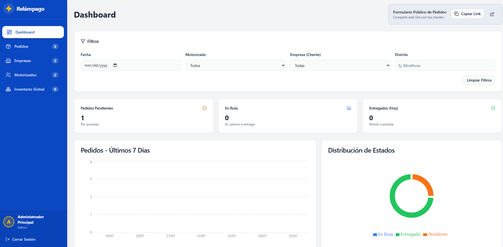
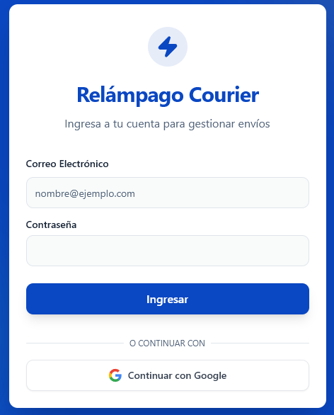

# Relampago Courier

Relampago Courier is a delivery operations dashboard built for small logistics teams that need to intake orders, assign couriers, track delivery status, manage client inventory, and collect proof of delivery from the field.

This repository is presented as a portfolio project: it shows a full React + TypeScript application connected to Supabase, with role-based user flows for administrators, staff, couriers, and clients.

## Screenshots

### Admin dashboard



### Login



## What recruiters should notice

- **End-to-end product thinking:** the app covers the operational loop from public order intake to courier assignment, delivery confirmation, and inventory visibility.
- **Real backend integration:** Supabase Auth, database-backed workflows, role-aware access patterns, and storage-backed delivery proof uploads are part of the implementation.
- **Role-based UX:** different users see different workflows, keeping admin, courier, and client experiences focused.
- **Data-heavy UI:** dashboards, filters, sortable tables, inline editing, bulk assignment, and charts support day-to-day logistics work.
- **Modern frontend stack:** React, TypeScript, Vite, Tailwind CSS, Radix UI primitives, React Hook Form, Zod, Recharts, and Supabase JS.

## Product overview

Relampago Courier helps a delivery company coordinate orders between commercial clients, internal operators, and couriers.

Core workflows include:

- public order submission through `/pedido-express`
- admin/staff dashboard with delivery status metrics and filters
- order management with sorting, filtering, inline edits, payment details, tariffs, and bulk courier assignment
- courier mobile workflow for viewing assigned deliveries, starting routes, confirming delivery, and uploading photo proof
- public order form (`/pedido-express`, optionally personalised per company with `?c=<token>`): origin of the package (Relámpago warehouse vs. pickup at a saved/other address), service type (delivery, exchange, return, shipping agency), delivery time window, "call before", collection amount and payment method — all written through the `submit_order()` database function
- pickups (`/recojos`): one pickup can group several orders and be assigned to one or more couriers; couriers mark their part as picked up and the linked orders move to "recogido"
- companies with multiple addresses, contact, e-mail, Yape account and a private intake link
- live courier map for admin/staff: last known position of everyone who delivers (couriers and admins/staff flagged with `is_courier`), state by color and role by marker shape, per-day trails with delivery checkpoints and km travelled, active order destinations, and Google Maps links
- courier route screen (`/mi-ruta`): stops ordered by proximity (nearest neighbour + 2-opt), per-stop and full-route navigation in Google Maps
- background-friendly location reporting from the courier PWA (throttled GPS upserts + heartbeat), with the coordinate of every status change recorded in `order_events`
- company/client management with contact and logistics details
- stock management for client inventory
- protected routes based on user role

## User roles

| Role | Main capabilities |
| --- | --- |
| Admin | Dashboard, orders, companies, couriers, live map, global stock, assignment, reporting views |
| Staff | Dashboard, orders, companies, couriers, live map, day-to-day operations |
| Courier | Assigned deliveries, route status updates, delivery proof upload, location reporting |
| Client (merchant) | Self-service portal: place orders, track status and delivery proof, cancel pending orders, manage pickup addresses, stock, settlement reports, contact/Yape data and password |

Merchant accounts are created by Relámpago (new merchants are onboarded by phone): **Empresas → Nueva empresa** opens **Accesos** right away, which calls the `admin-users` Edge Function (service role) to create the user, reset a password or remove the account. There is no self-registration. The public order form (`/pedido-express`) is a transition tool with an on/off switch on the Dashboard (`app_settings.public_form_open`); when closed, `submit_order` only accepts orders from signed-in merchants or staff. Row Level Security scopes every table to the merchant's own company.

## Tech stack

- **Frontend:** React 19, TypeScript, Vite
- **Routing:** React Router
- **Auth and data:** Supabase Auth, Supabase Database (Postgres + Realtime), Supabase Storage
- **Forms and validation:** React Hook Form, Zod
- **UI:** Tailwind CSS, Radix UI primitives, Lucide icons
- **Maps:** Leaflet + react-leaflet with OpenStreetMap tiles; Nominatim for address search/reverse geocoding (no API key; keep within its 1 req/s usage policy)
- **Charts:** Recharts
- **PWA:** vite-plugin-pwa (installable on Android/iOS, auto-updating service worker)
- **Hosting:** Cloudflare Workers static assets via Wrangler
- **Tooling:** ESLint, TypeScript project references, Supabase CLI migrations

## Architecture at a glance

```text
src/
  components/       Shared layout, auth wrapper, protected routes, order form, courier tracking provider, UI primitives
  hooks/            Browser API hooks (screen wake lock)
  pages/            Role-based application screens (incl. CourierMap for admin/staff)
  lib/              Supabase client, geo helpers and shared utilities
  types/            Typed Supabase data model
supabase/
  migrations/       Versioned schema changes applied with the Supabase CLI
scripts/            Icon generation for the PWA
```

Supabase tables represented in the typed model include:

- `profiles` (`is_courier` marks admins/staff who also deliver)
- `companies` (e-mail, Yape, `intake_token` for the private form link) and `company_addresses`
- `orders` (`order_number`, origin, `pickup_id`, service type, time window, payment form, agency data, optional `destination_lat/lng`)
- `pickups` and `pickup_assignments` (many couriers per pickup)
- `order_items`
- `stock`
- `deliveries`
- `courier_locations` — last known position per courier (Realtime enabled)
- `courier_location_history` — trail, filled by trigger, purged after 7 days
- `order_events` — audit of status/assignment changes with the actor's coordinate

## Getting started

### Prerequisites

- Node.js 20+
- npm
- a Supabase project and the [Supabase CLI](https://supabase.com/docs/guides/cli)
- a Cloudflare account (only for deploying)

### Installation

```bash
npm install
```

### Environment variables

Create a `.env` file from the example:

```bash
cp .env.example .env
```

Then configure:

```bash
VITE_SUPABASE_URL=your-supabase-project-url
VITE_SUPABASE_ANON_KEY=your-supabase-anon-key
```

### Run locally

```bash
npm run dev
```

### Build

```bash
npm run build
```

### Lint

```bash
npm run lint
```

### Ad-hoc SQL and data import

```bash
npm run sql -- "select count(*) from orders"          # runs against the linked project (needs SUPABASE_DB_PASSWORD in .env)
node scripts/import-history.mjs --orders form.csv --pickups recojos.csv --since 2026-06-20 --dry-run
```

`scripts/import-history.mjs` loads the Google Form export (orders) and the pickup log (companies, addresses with parsed coordinates/Plus Codes, pickups) used before this app existed.

Districts come from a single catalog table (`public.districts`: name, prices, agency flag, aliases). Every district column (orders, pickups, company addresses, companies) has a foreign key to it, and a trigger converts whatever arrives (`"San Luis (s/10.00)"`, `"Santiago de Surco"`, `"SJL"`) to the official name, so no free-text district can be stored. Forms use the shared `DistrictSelect`; the fixed tariff of a district is read from the catalog.

Merchant portal rules: every order goes through a review/confirm step; pickups can only use the merchant's registered addresses (Relámpago manages addresses — merchants see them read-only in *Mi comercio*); announcements (`public.announcements`, one active at a time) open once when merchants enter the portal; bulk upload (`/carga-masiva`) reads the Excel template (district as a dropdown, generated with ExcelJS loaded on demand), CSV or rows pasted from Excel/Sheets, validates each row and submits them atomically through `submit_orders_bulk`.

Warehouse stock: when an order leaves the warehouse the merchant picks products from their stock (`stock_availability` = quantity − units committed to orders not yet delivered). Stock is deducted when the order is delivered (reverted if the delivery is undone) by a trigger on `orders.status`, and every quantity change is logged in `stock_movements`.

Pickup addresses are placed with an Uber-style picker (`LocationPicker` / `MapPickerDialog`): type-ahead suggestions (Photon), search (Nominatim), "use my location" with GPS accuracy, full-screen mode, and street/district auto-filled from the pin.

`scripts/merge-companies.mjs --propose` finds companies that are the same merchant spelled differently (normalized name + trigram similarity) and writes an editable JSON; `--apply file.json [--dry-run]` moves orders, pickups, addresses, stock, settlements and accounts to the kept company and deletes the duplicates.

### Regenerate PWA icons

```bash
npm run icons              # from public/icon.svg
npm run icons -- path.png  # from any square image
```

## Supabase setup notes

Schema changes live in `supabase/migrations/` and are applied with the CLI:

```bash
supabase link --project-ref <your-project-ref>   # once; asks for the database password
supabase db push                                  # applies pending migrations
supabase gen types typescript --linked > src/types/database.ts
supabase functions deploy admin-users --use-api      # Edge Function used by Empresas → Accesos (no Docker needed)
```

The base tables (`profiles`, `companies`, `orders`, `order_items`, `stock`, `deliveries`) and their RLS policies predate the migrations folder; run `supabase db pull` after linking to capture them as a baseline migration.

For delivery proof uploads, create a Supabase Storage bucket named `proofs` and configure access policies appropriate for your deployment.

For Google login in production, add your deployed URL to **Authentication → URL Configuration → Redirect URLs** in the Supabase dashboard.

## Deploy (Cloudflare Workers)

Live: https://relampago-courier.carthe5kboy.workers.dev

The app is served as static assets from a Worker (`wrangler.jsonc`, SPA fallback enabled).

```bash
npx wrangler login   # once
npm run deploy       # builds with the VITE_* vars from .env, then wrangler deploy
```

Because Vite inlines `VITE_*` variables at build time, `.env` must exist before building.

## Portfolio context

I built this project to demonstrate practical frontend engineering in a business workflow: translating logistics operations into a typed, role-aware web application with real authentication, database integration, and field-worker interactions.

The strongest parts of the project are the operational UI patterns: dense tables, filtered dashboards, bulk updates, route-specific courier views, public intake, and proof-of-delivery handling.
